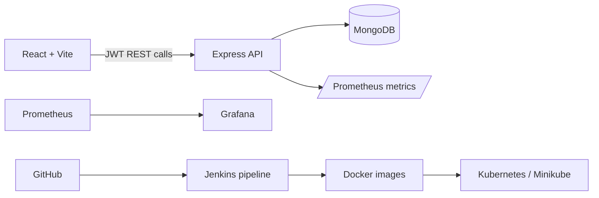

# Secure CI/CD and Monitoring Pipeline for a Banking Transaction Demo

> **Educational demo only.** This application uses fictional accounts and simulated money. It must not be connected to real financial services or used to process real money.

## What this project demonstrates

This portfolio project combines a React/Vite client with a Node.js/Express REST API, MongoDB persistence, automated tests, Docker, Jenkins, Kubernetes, Prometheus, and Grafana. The backend owns all balance calculations and protected operations; the browser never supplies or decides an account balance.



## Prerequisites

- Node.js 22+, npm, and Git
- MongoDB 7/8 locally, or Docker Desktop
- Optional: Jenkins, Docker, Minikube/kubectl, Prometheus, Grafana, and a Chrome/Chromedriver installation for Selenium

## Local Node development

```powershell
Copy-Item .env.example .env
npm install
npm run install:all
# Start MongoDB, then:
npm run seed --prefix backend
npm run dev
```

Open <http://localhost:5173>. The seeded demo users are `alex@example.test` and `sam@example.test`, both with password `DemoPass123!`. All data is synthetic.

Useful URLs: frontend `5173`, API `4000`, health `http://localhost:4000/health`, metrics `http://localhost:4000/metrics`.

## Tests and quality checks

```powershell
npm test
npm run lint
npm run build --prefix frontend
npm run audit --prefix backend
cd selenium; npm install; npm test
```

The API tests use `mongodb-memory-server`. Selenium requires the app, MongoDB, a browser, and its driver to be running. Commands not executed in this environment are intentionally not described as passed.

## Docker Compose

Create `.env` and set a strong local-only `JWT_SECRET`, then:

```powershell
docker compose up --build
docker compose logs -f backend
docker compose down
```

The UI is at <http://localhost:8080> and the API is at <http://localhost:4000>. The Compose MongoDB is a standalone server. MongoDB transactions require a replica set; the transfer route therefore expects a transaction-capable deployment. For a local educational run, use the documented transaction limitation and do not treat this as production-grade financial consistency.

## Jenkins

[`Jenkinsfile`](Jenkinsfile) checks out the repository, installs lockfile dependencies, runs lint/tests/audit, builds the client and images, and only runs the optional demo deployment when `DEPLOY_DEMO=true`. Configure the Node 22 and Docker tools, credentials/environment variables (`JWT_SECRET`, registry credentials if publishing is added), and archive permissions in Jenkins. The pipeline does not claim to have run until you configure and execute it.

## Kubernetes / Minikube

```powershell
minikube start
docker build -f docker/backend.Dockerfile -t secure-banking-api:local .
docker build -f docker/frontend.Dockerfile -t secure-banking-web:local .
minikube image load secure-banking-api:local
minikube image load secure-banking-web:local
kubectl apply -f k8s/app.yaml
kubectl -n secure-banking create secret generic banking-secrets --from-literal=JWT_SECRET="$(New-Guid)"
kubectl -n secure-banking rollout status deploy/backend
kubectl -n secure-banking get pods,svc
minikube service frontend -n secure-banking
```

The checked-in Secret contains a placeholder and must be replaced. MongoDB is internal-only. For production-like use, use a managed replica-set database and an external secret manager.

## Monitoring

Run Prometheus with [`monitoring/prometheus.yml`](monitoring/prometheus.yml) and load [`monitoring/grafana/datasource.yml`](monitoring/grafana/datasource.yml) into Grafana. Scrape `backend:4000/metrics` from the same Docker network. The API emits request totals/durations, failed logins, transfer outcomes, and default process metrics. [`monitoring/alerts.yml`](monitoring/alerts.yml) contains availability and error-rate rules. Metric labels deliberately exclude user IDs, account numbers, and transaction IDs.

## Security controls and limitations

- bcrypt password hashes, short-lived JWTs, protected routes, Joi validation, Helmet, CORS, rate limiting, redacted request logs, non-root backend container, probes, resource limits, and audit gates are included.
- Secrets belong in environment variables, Jenkins Credentials, or Kubernetes Secret references. Rotate them by issuing a new secret, restarting workloads, and revoking the old secret.
- This demo has no MFA, external identity provider, HSM, fraud detection, audit immutability, key management service, formal threat model, high availability, or compliance controls. It is not suitable for real banking.

## Important files

- [`backend/src/app.js`](backend/src/app.js): API middleware, health, metrics, and routes.
- [`backend/src/routes/transactions.js`](backend/src/routes/transactions.js): authenticated transfer and idempotency behavior.
- [`frontend/src/main.jsx`](frontend/src/main.jsx): client routes and protected layout.
- [`docker-compose.yml`](docker-compose.yml), [`Jenkinsfile`](Jenkinsfile), [`k8s/app.yaml`](k8s/app.yaml): delivery assets.
- [`docs/viva-guide.md`](docs/viva-guide.md): presentation and viva preparation.

## Demonstration checklist

1. Start MongoDB and the app; seed demo data.
2. Sign in as Alex and show the dashboard and transactions.
3. Transfer a small fictional amount to Sam and show the updated balance.
4. Try a negative/zero amount, invalid recipient, and insufficient balance.
5. Open `/health` and `/metrics`.
6. Run API tests and show the Jenkinsfile, Dockerfiles, Kubernetes probes, and monitoring rules.

